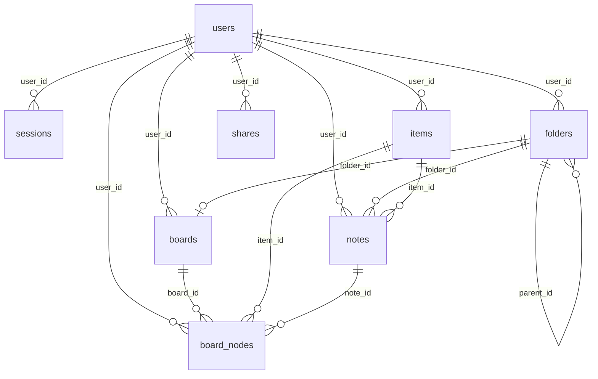

# Контракт данных (D1)

Схема базы Cloudflare D1 для «Полки»: таблицы, связи, инварианты и правила.
Источник правды — миграции в [`app/migrations/`](app/migrations/), этот файл
описывает состояние после `0012_drop_ai_folder.sql`.

- Локальная база: `.wrangler/state/v3/d1` (`npm run d1:migrate`);
- боевая: `npm run d1:migrate:remote`;
- все id — `TEXT` (uuid или читаемый slug), время — ISO-8601 UTC в `TEXT`;
- `user_id = NULL` означает «общая» запись (наследие до привязки к аккаунту);
  гость видит только такие строки.

## ER-диаграмма



Логически:

```
users
 ├─ sessions            (вход; в базе только хеш токена)
 ├─ items               (карточки-источники: ссылки/видео/статьи)
 ├─ folders             (дерево; у каждого пользователя ровно один корень)
 │   ├─ boards          (ровно одна доска у верхней папки)
 │   │   └─ board_nodes (позиции карточек и файлов на холсте)
 │   └─ notes           (файлы/заметки; опционально ссылаются на items)
 └─ shares              (публичные ссылки на папку или доску)
```

## Таблицы

### `users`

| Колонка | Тип | Ограничения | Смысл |
|---|---|---|---|
| `id` | TEXT | PK | uuid пользователя |
| `email` | TEXT | NOT NULL, UNIQUE | логин; хранится в нижнем регистре |
| `password_hash` | TEXT | NOT NULL | PBKDF2-SHA256 (base64) |
| `password_salt` | TEXT | NOT NULL | индивидуальная соль |
| `iterations` | INTEGER | NOT NULL | число итераций PBKDF2 (сейчас 100 000) |
| `is_premium` | INTEGER | NOT NULL DEFAULT 0 | 1 — ИИ через серверный ключ |
| `created_at` | TEXT | NOT NULL | ISO-время регистрации |

Индексы: `email` — UNIQUE (неявный).

### `sessions`

| Колонка | Тип | Ограничения | Смысл |
|---|---|---|---|
| `id` | TEXT | PK | uuid сессии |
| `user_id` | TEXT | NOT NULL → `users.id` CASCADE | владелец |
| `token_hash` | TEXT | NOT NULL, UNIQUE | SHA-256 токена; сам токен не хранится |
| `user_agent` | TEXT | | обрезанный UA (для логов) |
| `created_at` | TEXT | NOT NULL | выдача |
| `expires_at` | TEXT | NOT NULL | срок (30 дней) |

Индексы: `idx_sessions_user (user_id)`, `idx_sessions_expires (expires_at)`.

### `items` — карточки

| Колонка | Тип | Ограничения | Смысл |
|---|---|---|---|
| `id` | TEXT | PK | uuid карточки |
| `type` | TEXT | NOT NULL | `youtube` / `tiktok` / `article` / `note` |
| `url` | TEXT | | обязателен для youtube/tiktok/article, может быть `NULL` |
| `title` | TEXT | NOT NULL | заголовок |
| `thumbnail` | TEXT | | обложка |
| `summary` | TEXT | | саммари ИИ |
| `content` | TEXT | | транскрипт/текст |
| `file_id` | TEXT | | наследие; кодом не используется |
| `created_at` | TEXT | NOT NULL | |
| `updated_at` | TEXT | NOT NULL | обновляется кодом, не триггером |
| `user_id` | TEXT | → `users.id` CASCADE | `NULL` — «общая» карточка |

Индексы: `idx_items_created_at (created_at)`, `idx_items_user (user_id)`.

### `folders` — папки (дерево)

| Колонка | Тип | Ограничения | Смысл |
|---|---|---|---|
| `id` | TEXT | PK | uuid или читаемый id (`root-<uid>`, `design-<uid8>`) |
| `name` | TEXT | NOT NULL | отображаемое имя |
| `slug` | TEXT | UNIQUE | необязательный читаемый слаг |
| `created_at` | TEXT | NOT NULL | |
| `user_id` | TEXT | → `users.id` CASCADE | `NULL` — общая папка (legacy) |
| `is_root` | INTEGER | NOT NULL DEFAULT 0 | 1 — «Мои знания» |
| `parent_id` | TEXT | → `folders.id` CASCADE | у верхних папок `NULL` |

Индексы:
- `idx_folders_user (user_id)`;
- `idx_folders_root (user_id) WHERE is_root = 1` — **не больше одного корня** на пользователя.

Правила:
- корень («Мои знания») создаётся лениво (`ensureRootFolder`) и не удаляется;
- удаление папки не удаляет файлы: `notes.folder_id` становится `NULL`
  (объявлено `ON DELETE SET NULL`, но код дополнительно обнуляет вручную).

### `notes` — файлы/заметки

| Колонка | Тип | Ограничения | Смысл |
|---|---|---|---|
| `id` | TEXT | PK | uuid |
| `folder_id` | TEXT | → `folders.id` SET NULL | папка; `NULL` — корень дерева |
| `item_id` | TEXT | → `items.id` SET NULL | карточка-источник (опционально) |
| `title` | TEXT | NOT NULL | название файла |
| `content` | TEXT | NOT NULL | текст/markdown |
| `url` | TEXT | | ссылка источника |
| `created_at` | TEXT | NOT NULL | |
| `updated_at` | TEXT | NOT NULL | |
| `user_id` | TEXT | → `users.id` CASCADE | `NULL` — «общая» |

Индексы: `idx_notes_folder`, `idx_notes_item`, `idx_notes_user`.

Правила:
- файл переживает удаление карточки (`item_id` → `NULL`, миграция `0008`);
- у одной карточки может быть несколько заметок в разных папках;
- `folder_id = NULL` показывается в корне дерева.

### `boards` — доски

| Колонка | Тип | Ограничения | Смысл |
|---|---|---|---|
| `id` | TEXT | PK | `board-<folderId>` |
| `folder_id` | TEXT | NOT NULL, UNIQUE → `folders.id` CASCADE | папка доски |
| `user_id` | TEXT | NOT NULL → `users.id` CASCADE | владелец |
| `created_at` | TEXT | NOT NULL | |

Индексы: `idx_boards_folder` — UNIQUE (`folder_id`), `idx_boards_user`.

Правила:
- доска есть у **каждой папки верхнего уровня** (`parent_id IS NULL`),
  включая корень;
- у вложенной папки своей доски нет: `ensureBoard` возвращает доску
  родителя, и её содержимое рисуется там же;
- доска создаётся лениво при первом открытии/публикации.

### `board_nodes` — узлы доски

| Колонка | Тип | Ограничения | Смысл |
|---|---|---|---|
| `id` | TEXT | PK | uuid узла |
| `item_id` | TEXT | → `items.id` CASCADE | узел-карточка (иначе `NULL`) |
| `note_id` | TEXT | → `notes.id` CASCADE | узел-файл (иначе `NULL`) |
| `x`, `y` | REAL | NOT NULL DEFAULT 24 | координаты на холсте, px |
| `width` | REAL | | ширина блока |
| `height` | REAL | | высота (файлы меняются ресайзом) |
| `created_at` | TEXT | NOT NULL | |
| `updated_at` | TEXT | NOT NULL | |
| `user_id` | TEXT | → `users.id` CASCADE | наследие; новые узлы пишутся без него |
| `board_id` | TEXT | → `boards.id` CASCADE | доска, на которой лежит узел |

Индексы:
- `idx_board_nodes_board (board_id)`;
- `idx_board_nodes_user (user_id)`;
- `idx_board_nodes_board_item (board_id, item_id) WHERE item_id IS NOT NULL` — UNIQUE;
- `idx_board_nodes_board_note (board_id, note_id) WHERE note_id IS NOT NULL` — UNIQUE.

Инварианты (на уровне кода, CHECK в базе нет):
- ровно одно из `item_id` / `note_id` заполнено;
- на одной доске карточка/заметка встречается не более одного раза,
  но на разных досках — может (миграция `0011`);
- координаты — логические px до масштабирования зумом.

### `shares` — публичные ссылки

| Колонка | Тип | Ограничения | Смысл |
|---|---|---|---|
| `id` | TEXT | PK | uuid ссылки |
| `user_id` | TEXT | NOT NULL → `users.id` CASCADE | владелец |
| `kind` | TEXT | NOT NULL | `folder` или `board` |
| `ref_id` | TEXT | | `folders.id` при `kind = folder`, `boards.id` при `kind = board` |
| `slug` | TEXT | NOT NULL, UNIQUE | короткий id в ссылке |
| `created_at` | TEXT | NOT NULL | |
| `board_id` | TEXT | → `boards.id` CASCADE | **не используется** (наследие `0010`); актуальная связь — `ref_id` |

Индексы: `idx_shares_user`, `idx_shares_ref`, `idx_shares_board`.

Правила:
- ссылка открывается без входа: `GET /api/public/:slug` → `/board?share=<slug>`;
- для папки отдаётся её доска (узлы + заметки + карточки), для доски — сама доска;
- ссылку можно отозвать в любой момент (`DELETE /api/shares/:slug`),
  публичный ответ отдаётся с `cache-control: no-store`;
- при удалении папки её ссылки (на папку и на доску) удаляются.

## Владение и видимость

Правило одно для всех выборок и мутаций (`app/server/utils/scope.ts`):

| Кто | Что видит |
|---|---|
| авторизованный | строки с `user_id = <свой>` **или** `user_id IS NULL` |
| гость | только `user_id IS NULL` |

- чужие строки не видны и не изменяются никогда;
- `GET /api/folders` для гостя возвращает пустой список;
- права выдаются только по токену (`Authorization: Bearer` или httpOnly
  cookie `polka_session`), `Origin`/`User-Agent` — только для логов.

## API → таблицы (кратко)

| Ручка | Таблицы |
|---|---|
| `POST /api/auth/register`, `/login` | `users`, `sessions`, `folders` (корень) |
| `GET /api/auth/me` | `sessions`, `users` |
| `GET/POST /api/items`, `PATCH/DELETE /api/items/:id` | `items` |
| `GET /api/folders` | `folders`, `boards` |
| `POST /api/folders`, `POST /api/folders/:id/copy`, `DELETE /api/folders/:id` | `folders`, `boards`, `notes`, `board_nodes` |
| `POST /api/folders/reset` | `folders`, `notes`, `boards` |
| `GET/POST /api/notes`, `GET/PATCH/DELETE /api/notes/:id` | `notes` |
| `GET /api/boards/:folderId` | `boards`, `board_nodes`, `notes`, `items` |
| `PATCH /api/boards/:folderId/nodes/:key` | `board_nodes` |
| `GET/POST /api/shares`, `DELETE /api/shares/:slug` | `shares` |
| `GET /api/public/:slug` | `shares`, `boards`, `board_nodes`, `notes`, `items`, `users` (email автора) |

## Миграции

| Файл | Что делает |
|---|---|
| `0001_init` | `items` |
| `0002_card_fields` | новая модель карточки (`summary`, `thumbnail`, `content`, `file_id`, `updated_at`) |
| `0003_notes` | `folders`, `notes` |
| `0004_board` | `board_nodes` (одна доска на пользователя) |
| `0005_auth` | `users`, `sessions` |
| `0006_premium` | `users.is_premium` |
| `0007_ownership` | `user_id` во всех доменных таблицах |
| `0008_keep_notes` | `notes.item_id` → `ON DELETE SET NULL` |
| `0009_shares` | `shares` |
| `0010_workspaces` | корень «Мои знания», `boards`, `folders.parent_id/is_root`, `board_nodes.board_id` |
| `0011_board_node_unique_per_board` | уникальность узлов в пределах доски |
| `0012_drop_ai_folder` | удаление служебной `ai-voult`, заметки → в корень |

## Правила для новых изменений

1. Любая правка схемы — **новая миграция** в `app/migrations/NNNN_*.sql`,
   существующие не редактируются (они уже применены на проде).
2. Новые таблицы: `id TEXT PRIMARY KEY`, `created_at TEXT NOT NULL`,
   при необходимости `user_id TEXT REFERENCES users(id) ON DELETE CASCADE`.
3. Время пишется из кода (`new Date().toISOString()`), триггеров нет.
4. SQLite не умеет менять FK/NOT NULL на месте — используйте «12-step»
   пересборку таблицы (см. `0002`, `0008`).
5. Не полагайтесь на `PRAGMA foreign_keys`: код чистит связанные строки явно
   (например, удаление папки снимает её ссылки и обнуляет `notes.folder_id`).
6. Перед деплоем: `npm run d1:migrate:remote` — пуш кода миграции не применяет.
